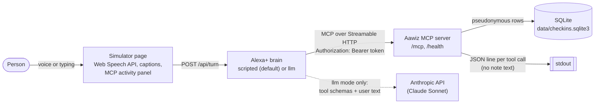

# Aawiz Voice Check-in

## Nebius x NVIDIA: Personal AI

**Live demo: https://aawiz-voice-checkin.onrender.com** (synthetic data only; if it has been
idle, the first load takes about a minute while the free instance wakes up)

This branch (`feature/nebius-personal-ai`) adds an agent brain that runs on **Nebius Token
Factory** with an **NVIDIA open model**, `nvidia/Nemotron-3_5-Lightning`.

**What the Nebius brain does.** You talk to the check-in assistant in your own words. On every
turn the simulator makes a runtime call to the Nebius Token Factory inference API
(`https://api.tokenfactory.nebius.com/v1/`, the OpenAI-compatible chat completions endpoint).
Nemotron receives the seven tools of our MCP server as function definitions, built from the
server's live `tools/list`, and decides which to call. Each call then goes through a real MCP
client over Streamable HTTP, so the "MCP activity" panel shows what the model did. The header
shows `Brain: Nebius · nvidia/Nemotron-3_5-Lightning`.

**Why it fits Personal AI.**

- **Memory** is the person's own check-in history: dates, three scores, optional sleep and
  note. The model never invents it; it reads it through tools.
- **Skills** are the MCP tools: log a check-in, reflect on the week, suggest one small action,
  explain privacy, export, delete.
- **The data is under the person's control**, enforced in code, not left to the model:
  - Consent: `set_consent` runs only when the person has just answered the consent question, and
    what they said decides the values ("scores only" stores no notes). The model cannot grant
    consent on its own. `log_checkin` refuses on the server when consent is missing.
  - Delete: the model may ask for `delete_my_data`, but it runs only after the person says
    yes to a delete question.
  - Export: everything kept about the person, as JSON, by asking.

**Guardrails around the model.**

- The crisis check runs before any call to Nebius. On crisis language no request is sent and
  only the fixed safety message is shown.
- Every reply passes the banned-word guard. If it fails, or the model returns no words, the
  scripted brain answers that turn instead.
- At most 4 tool calls per turn, a 15-second timeout, no retries. On any Nebius error the
  scripted brain answers that turn and the header says `Brain: scripted (fallback)`.
- The system prompt says the assistant is not a medical service, never diagnoses, and only
  describes patterns in the person's own check-ins.

**The model.** Token Factory listed four NVIDIA models on 13 October 2026, all with tool
support: Nemotron 3 Nano (30B), Nemotron 3.5 Lightning (30B), Nemotron 3 Super (120B) and
Nemotron 3 Ultra (550B). The two smallest are the same size and price. We ran the same
eight-turn conversation through each: Lightning called the right tool on every turn in about
7 seconds for the whole conversation; Nano needed about 58 seconds. So we chose
`nvidia/Nemotron-3_5-Lightning`.

**Model license.** `nvidia/Nemotron-3_5-Lightning` is released under the OpenMDW-1.1 license
([NVIDIA NGC model card](https://catalog.ngc.nvidia.com/orgs/nim/nvidia/models/nemotron-3.5-lightning/-/model-card/safety-and-security):
"Use of this model is governed by the OpenMDW License Agreement, version 1.1").

First request after a quiet period may take a few seconds.

**Run it.**

```bash
pip install -e ".[nebius]"
# in .env: BRAIN_MODE=nebius, NEBIUS_API_KEY=<your key>, NEBIUS_MODEL=nvidia/Nemotron-3_5-Lightning
make demo
make nebius-smoke     # optional: lists the NVIDIA models, runs two turns, prints tokens used
```

**Hosted demo.** The public demo runs with `DEMO_PUBLIC=true`: synthetic data only, a random
pseudonym per visitor with an invented 14-day history, everything deleted after two hours, at
most 20 Nebius turns per visitor per hour and 300 per day. If the host sets `ELEVENLABS_API_KEY`,
replies are spoken in Elin's voice up to a daily budget (`DEMO_VOICE_CHARS_PER_DAY`, default 3000
characters); above it the browser's voice is used. It is one container, built from
[`deploy/Dockerfile.demo`](deploy/Dockerfile.demo), that listens on the host's `PORT`; the only
setting it needs is the secret `NEBIUS_API_KEY`. It runs on a free Render web service in
Frankfurt: https://aawiz-voice-checkin.onrender.com

The demo is hosted on a free instance that goes to sleep after 15 minutes without visitors. If
it has been idle, the first load takes about a minute while it wakes up; after that it is fast.

**Built during the Nebius submission period** (commit dates on this branch):

| Date (2026) | What |
|---|---|
| 12 October | Public demo mode: per-visitor synthetic users, two-hour purge, cost caps |
| 12 October | The Nebius brain: MCP tools as functions, crisis gate, guard, fallbacks, limits |
| 12 October | Mocked-Nebius tests, `make nebius-smoke`, Hugging Face Space files |
| 13 October | Model choice from live runs; consent and delete enforced in code |

The MCP server, the simulator and Aawiz mode below were built from 10 to 12 October 2026 for
the Amazon App Dev Hackathon and are the base this branch builds on.

---

Demo video (under 3 minutes): https://youtu.be/agGxav0tBmY

Friction log for the hackathon: [docs/FRICTION_LOG.md](docs/FRICTION_LOG.md)

A 30-second daily check-in for Alexa+: say how your mood, energy and stress are, and hear back
how your week is going, one small thing to try right now, and exactly what is kept about you.

Built by [AAwiz B.V.](https://www.aawiz.net) (Leeuwarden, Netherlands) for the Amazon App Dev
Hackathon 2026, Alexa+ track and Open Source mini-challenge.

**Not a medical device.** It does not diagnose, treat or give medical advice. It reflects
patterns in your own check-ins, in plain language, and never claims certainty.

## Why

Stress and low energy usually build up quietly. Most people only notice when a week has
already gone badly. A voice check-in is the lowest-effort habit there is: no app to open, no
form to fill, three numbers said out loud while the kettle boils. Over a week, those numbers
show a direction that is easy to miss day by day.

The people who need this most are also the people least willing to hand their feelings to an
app that harvests them. So privacy is the product here, not a footnote: explicit consent,
pseudonymous IDs, three numbers instead of a diary, export and delete by voice, and automatic
deletion after 90 days.

## What it does

| Tool | What it does |
|---|---|
| `set_consent` | Records two separate consents: `scores` (numbers) and `notes` (free text). |
| `log_checkin` | Mood, energy and stress (1 to 5), optional sleep hours and a short note. Refused without `scores` consent; the note is dropped without `notes` consent. |
| `get_weekly_reflection` | The last 7 days against the 7 before: averages, direction per score, best and hardest day, and one plain sentence of at most 35 words. |
| `suggest_micro_action` | One low-risk action from a fixed list (4-7-8 breathing, a short walk, water, a screen break, one good thing, a message to a friend), chosen deterministically from the latest scores. |
| `get_privacy_summary` | What is stored, why, for how long, and how to delete it. |
| `export_my_data` | Everything kept about this user, as JSON. |
| `delete_my_data` | Deletes all of this user's check-ins and consent records at once. |

## Architecture



- **MCP server** (`server/`): the official [MCP Python SDK](https://pypi.org/project/mcp/)
  2.3.0, Streamable HTTP at `/mcp`. It negotiates protocol `2025-11-25` through the initialize
  handshake and `2026-07-28` through the SDK's default connect mode; tests check both. Bearer
  tokens map to pseudonyms; a missing or unknown token gets `401`.
- **Simulator** (`simulator/`): a Starlette app and a plain HTML/CSS/JS page with no build step.
  Its backend is a real MCP client: every tool call you see in the activity panel is a live
  `tools/call` to the server over Streamable HTTP.
- **Brains**: `scripted` (default) is a deterministic intent router, so anyone can reproduce
  the demo without an API key. `llm` lets Claude read the MCP tool schemas and decide which
  tools to call.
- **Policy in one file**: banned clinical words, crisis phrases, regional resources and the
  micro-actions all live in [`server/policy.json`](server/policy.json).

## Quick start

Needs Python 3.11 or newer. Chrome or Edge for voice input (typing works everywhere).

```bash
git clone https://github.com/Aawizgroup/aawiz-voice-checkin.git
cd aawiz-voice-checkin
make install        # venv, dependencies, Chromium for the e2e test
make demo           # seeds synthetic data, starts the server and the simulator
```

Open <http://127.0.0.1:8001> and say or type the demo flow below.

Without `make` (for example on Windows):

```bash
python -m venv .venv
.venv/Scripts/python -m pip install -e ".[dev]"      # .venv/bin/python on macOS and Linux
cp .env.example .env
.venv/Scripts/python scripts/seed_demo.py
.venv/Scripts/python -m server        # terminal 1, port 8000
.venv/Scripts/python -m simulator     # terminal 2, port 8001
```

With Docker:

```bash
docker build -t aawiz-voice-checkin .
docker run -p 8000:8000 -p 8001:8001 aawiz-voice-checkin
```

### Configuration

Copy `.env.example` to `.env`. The important settings:

| Variable | Default | Meaning |
|---|---|---|
| `AAWIZ_TOKENS` | | `token:pseudonym` pairs, comma separated. Change the example tokens. |
| `SIM_TOKEN` | | The token the simulator uses to call the server. |
| `AAWIZ_REGION` | `NL` | Region for crisis resources (`NL` or `US`). |
| `AAWIZ_DATA_DIR` | `./data` | Folder for the SQLite file (git-ignored). |
| `BRAIN_MODE` | `scripted` | `scripted`, `llm` or `nebius`. |
| `NEBIUS_API_KEY` | | Only for `nebius` mode. Secret. |
| `NEBIUS_MODEL` | `nvidia/Nemotron-3_5-Lightning` | Only for `nebius` mode. |
| `DEMO_PUBLIC` | `false` | `true` for the hosted public demo. |
| `ANTHROPIC_API_KEY` | | Only for `llm` mode. |
| `LLM_MODEL` | `claude-sonnet-5-5` | Only for `llm` mode. |
| `BACKEND_MODE` | `local` | `local` or `aawiz` (see [Aawiz mode](#aawiz-mode-the-real-product-and-elins-voice)). |
| `AAWIZ_API_BASE` | `https://aawiz-api.azurewebsites.net/` | Only for `aawiz` mode. |
| `AAWIZ_SESSION_FILE` | `data/aawiz_session.json` | Only for `aawiz` mode. Git-ignored. |
| `ELEVENLABS_API_KEY` | | Optional. Elin's voice for replies. |
| `ELEVENLABS_VOICE_ID` | `DODLEQrClDo8wCz460ld` | The Lauren B library voice. |
| `ELEVENLABS_MODEL_ID` | `eleven_flash_v2_5` | Low-latency text-to-speech model. |

For `llm` mode: `pip install -e ".[llm]"`, set `BRAIN_MODE=llm` and `ANTHROPIC_API_KEY`. If the
key or package is missing, the simulator falls back to `scripted` and says so on the page.

## Demo flow

| You say | The assistant | MCP tool |
|---|---|---|
| "Alexa, open Aawiz check-in." | Greets you and asks for consent | (none yet) |
| "Yes, scores and notes." | Confirms what it will keep | `set_consent` |
| "My mood is 2, energy 3, stress 4, I slept 6 hours." | Confirms the check-in | `log_checkin` |
| "How was my week?" | Speaks the weekly reflection | `get_weekly_reflection` |
| "What can I do right now?" | Suggests one small action | `suggest_micro_action` |
| "What do you keep about me?" | Reads the privacy summary | `get_privacy_summary` |
| "Delete my data." then "Yes." | Asks to confirm, then deletes everything | `delete_my_data` |

**The demo data is synthetic.** `scripts/seed_demo.py` creates 14 days of invented check-ins
for the pseudonym `user_demo`, each labelled "Synthetic demo data", so the weekly reflection has
something to say in the video. No real person's data is used.

## Aawiz mode: the real product and Elin's voice

Everything above runs locally and is what judges can reproduce. Aawiz mode connects the same
Alexa+ conversation to the real [Aawiz](https://www.aawiz.net) companion app and to Elin, the
companion inside it. It needs an Aawiz account, so it is meant for the demo video, not for
reproduction.

What changes with `BACKEND_MODE=aawiz`:

| Tool | Aawiz mode |
|---|---|
| `log_checkin` | Also saves a real Aawiz mood check-in (`POST /api/v1/mood-tracker/entries/`). Elin hears about it the way she does in the app. |
| `get_weekly_reflection` | Speaks the real Aawiz weekly report (`GET /api/v1/mood-tracker/reports/weekly/`): its reflection lines, the mood direction this week, the streak. |
| `suggest_micro_action` | Speaks "Elin suggests" with its reason (`GET /api/v1/companion/suggestions/today/`). If there is none today, one item from the curated list. |
| `ask_elin` (new, eighth tool) | Sends one message to Elin through the app's chat (`POST /api/v1/chat/ticket/`, then the `ws/chat/` WebSocket) and speaks her reply. Elin remembers earlier conversations. |
| `set_consent`, `export_my_data` | Unchanged, on the local mirror. |
| `get_privacy_summary`, `delete_my_data` | Unchanged on the local mirror, plus: "Your Aawiz account and everything Elin knows is managed in the Aawiz app, where you can delete your account at any time." The connector never calls an account deletion endpoint. |

In local mode the tool list stays exactly seven.

**Score mapping.** An Aawiz check-in is one named mood; it has no energy, stress, sleep or note
field. Our mood score picks the mood, and the rest stays only in the local mirror:

| Our mood | Aawiz mood (its own score) |
|---|---|
| 1 | Heavy (2) |
| 2 | Down (2) |
| 3 | Neutral (5) |
| 4 | Happy (8) |
| 5 | Bright (9) |

The names and scores come from the Aawiz seed migration. Anxious and Worry are never chosen, so
the mapping never puts a worry label on someone who only said a number.

**Safety stays first.** The crisis check runs before any network call. On crisis language
nothing is sent to Aawiz, and the only thing spoken in Elin's voice is the fixed safety message.
Everything Aawiz sends back passes the same banned-word guard; a sentence that fails it is
dropped, and an Elin reply that fails it is not spoken (the caption says to read it in the app).

**Run it.**

```bash
pip install -e ".[aawiz]"     # adds the WebSocket client for ask_elin
# in .env: BACKEND_MODE=aawiz
make aawiz-login              # once: demo account email, then the code from the email
make demo
make aawiz-smoke              # optional: checks every step against production
```

`make aawiz-login` keeps only the refresh token and the session token, in
`data/aawiz_session.json` (git-ignored, owner-only permissions), and never prints a token. Access
tokens renew automatically 30 seconds before they expire (the Aawiz default lifetime is 5
minutes; production issued 7-day access tokens when we tested on 11 October 2026). On a `401`
the connector renews once and retries once. A read that times out is tried once more; a write
never is, so a check-in is not saved twice. In Aawiz mode the server loads the mood list at
startup, which also wakes an idle Aawiz server before the first check-in. Aawiz rotates refresh tokens: each renewal replaces the
saved one. A refresh token lasts 24 hours from its last use, so a session survives as long as
the skill is used at least once a day. If it ends, the skill says: "Your Aawiz demo session has
ended. Please run make aawiz-login."

### Elin's voice

With `ELEVENLABS_API_KEY` in `.env`, every assistant reply is spoken in Elin's voice: the
ElevenLabs library voice "Lauren B, Friendly & Comforting Voice for AI Companion & Assistants"
(`ELEVENLABS_VOICE_ID`, a public library voice, not a clone of a real person) with the
low-latency `eleven_flash_v2_5` model. The simulator turns only the reply text into audio, on
the server; your words and notes are never sent. Without a key, or if a call fails, the page
uses the browser's voice and the header says "Voice: browser". This works in either backend
mode.

## What we built during the hackathon

Aawiz (the companion app, its API and Elin) existed before the hackathon. Everything in this
repository is new, written during the submission period. Dates are commit dates from the git
history:

| Date (2026) | What |
|---|---|
| 10 October | The MCP server with seven tools, bearer auth, retention purge, and its tests |
| 10 October | The Alexa+ simulator: voice page, captions, MCP activity panel, scripted and LLM brains |
| 11 October | End-to-end browser test, docs, `make verify`, Docker and CI |
| 11 October | Aawiz mode: the connector to the real Aawiz API, the `ask_elin` tool, and Elin's voice |

## Privacy by design

- **Consent first, in two scopes.** Nothing is stored without `scores` consent. Notes are never
  stored without `notes` consent.
- **Data minimisation.** Date, three scores, optional sleep hours, optional note of at most 280
  characters. Nothing else.
- **Pseudonyms only.** No names, emails or device IDs. A token maps to an ID like `user_demo`.
- **Your rights by voice.** Hear the privacy summary, export everything as JSON, delete
  everything instantly.
- **Retention.** Check-ins older than 90 days are deleted at startup and once a day.
- **No analytics, no trackers, no selling.** Logs record the tool name, the pseudonym and the
  time, never the note text.
- **Where data goes.** In `scripted` mode with typing, nothing leaves your machine except calls
  to your own MCP server. Voice input in Chrome is sent to Google to be transcribed; typing
  avoids this. In `llm` mode, what you say is sent to the Anthropic API so Claude can choose
  tools. With Elin's voice, the assistant's reply text is sent to ElevenLabs (United States). In
  Aawiz mode, check-ins and Elin conversations are stored by Aawiz. Our server never receives or
  stores audio.

More in [docs/PRIVACY.md](docs/PRIVACY.md).

## Safety

If a note or anything you say contains crisis language, the assistant does not reflect on it,
does not store it, and answers calmly with real resources. For the Netherlands: 113 or
0800-0113 (free), chat at 113.nl, 112 in an emergency. For the US: call or text 988, 911 in an
emergency. Everyday hard days ("today was a hard day") are treated as ordinary check-ins.
Suggestions come only from a fixed list of low-risk actions. Details in
[docs/SAFETY.md](docs/SAFETY.md).

## Verification

```bash
make verify
```

Installs, lints, runs all tests, starts the server, calls `/health`, makes one real MCP
`tools/call` with a small client, checks that a request without a token gets `401`, and prints
`PASS` or `FAIL` per check. The tests include:

- **Protocol:** the official client negotiates `2025-11-25` or later; `tools/list` returns
  exactly the seven tools with described schemas.
- **Tools:** range validation (0, 6, 2.5 and strings are rejected), consent enforcement, the
  reflection math on a fixed fixture, the not-enough-data path, deterministic micro-actions.
- **Language guard:** no tool output contains a banned clinical word, over many fixtures.
- **Privacy:** export and delete are scoped to one user; user A can never read user B; the
  90-day purge works, also at startup.
- **Safety:** crisis phrases return the safety message with NL resources and store nothing;
  ordinary sad text does not trigger it.
- **Auth:** missing and invalid tokens get `401`.
- **End to end:** headless Chromium types the whole demo flow and checks the captions, the order
  of tools in the MCP activity panel, and the database before and after deletion.

### With the official MCP Inspector

```bash
npx @modelcontextprotocol/inspector --cli http://localhost:8000/mcp --transport http \
  --header "Authorization: Bearer <your token>" --method tools/list
npx @modelcontextprotocol/inspector --cli http://localhost:8000/mcp --transport http \
  --header "Authorization: Bearer <your token>" --method tools/call \
  --tool-name log_checkin --tool-arg mood=3 --tool-arg energy=3 --tool-arg stress=2
```

Or run `npx @modelcontextprotocol/inspector`, choose Streamable HTTP, enter
`http://localhost:8000/mcp`, and add the `Authorization: Bearer <token>` header. We ran all
seven tools this way with Inspector 2.10.1. Use the bearer header: without it the server
answers `401` and the Inspector offers an OAuth sign-in, which this server does not use.

## Limitations

- It runs as a self-hosted MCP server plus a web simulator of the Alexa+ conversation. It is
  not a published Alexa skill.
- Voice input uses the browser's Web Speech API, which works in Chrome and Edge. In Chrome,
  speech is sent to Google to be transcribed. Typing works in every browser and avoids this.
- Elin's voice sends the assistant's reply text to ElevenLabs in the United States.
- Aawiz mode needs an Aawiz account and a one-time email-code login, so judges cannot reproduce
  it; the local mode is the reproducible version. It stores check-ins and Elin conversations in
  Aawiz, on Microsoft Azure in the North Europe region (Ireland) according to the API's public
  host name, under the Aawiz privacy policy. Aawiz sends chat text to its language model provider
  to write Elin's replies.
- In Aawiz mode, energy, stress, sleep and notes stay only in the local mirror, because an
  Aawiz check-in has no field for them. `delete_my_data` deletes the local mirror only; the Aawiz
  account is deleted in the Aawiz app.
- Aawiz allows 10 mood check-ins per hour per account.
- The scripted brain understands the demo phrasings and close variants, not open conversation.
  The `llm` brain handles free speech but needs an Anthropic API key.
- Crisis detection is a phrase list in English and Dutch. It will miss indirect wording, which
  is why the message always points to people, not to the app.
- Tokens are static and configured locally. A production version would use OAuth.
- Dates use the server's local day.

## License

[Apache-2.0](LICENSE). Copyright 2026 AAwiz B.V.
